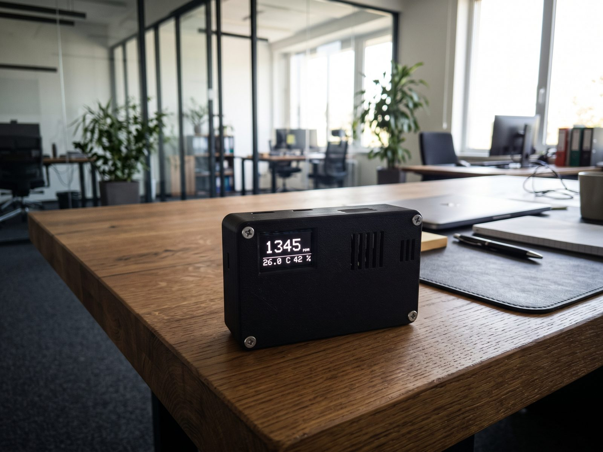
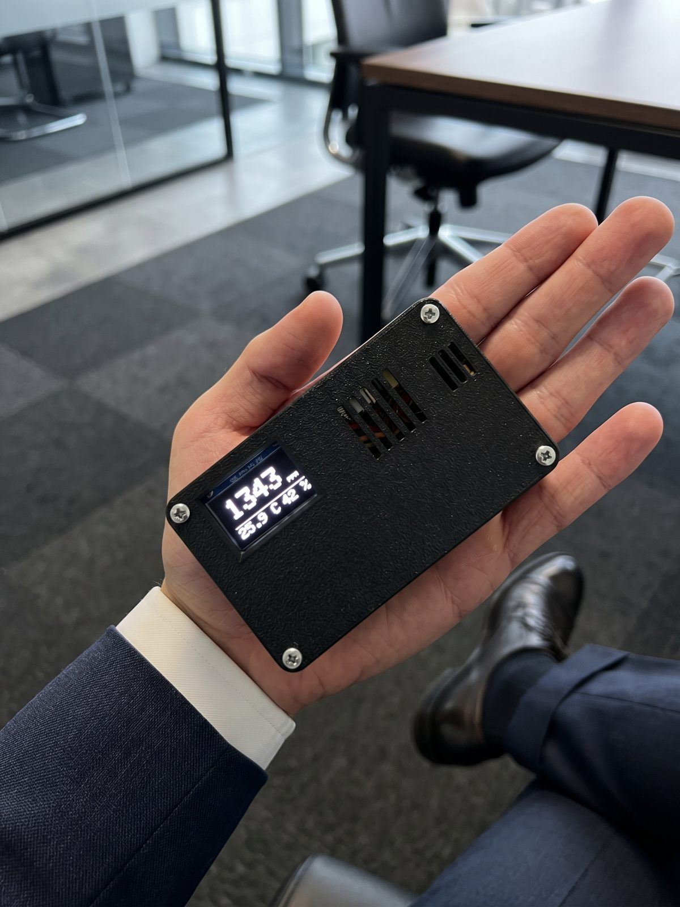

# Přenosný monitor CO₂ a prostředí

Kapesní přístroj, který měří koncentraci CO₂ (ppm), teplotu a relativní vlhkost vzduchu a zobrazuje je na OLED displeji. Napájí ho jeden článek 18650 nabíjený přes USB-C. Prototyp je postavený a funkční.



## Funkce

- CO₂ ze senzoru Sensirion SCD41, nová hodnota zhruba každých 5 s
- teplota a vlhkost z BME280 v samostatné větrané komůrce
- po zapnutí 30 s zahřívání s odpočtem
- chyba senzoru se vypíše přímo na displeji (např. `Chyba SCD41`)
- vlastní 3D tištěná krabička (základna + víko na 4 šrouby), 88 × 53,7 × 25,5 mm

## Hardware

| Součástka | Poznámka |
|---|---|
| ESP32-C3 SuperMini | řídicí jednotka |
| Sensirion SCD41 (deska LáskaKit) | CO₂, I²C 0x62 |
| LáskaKit Pidi BME280 | teplota a vlhkost, I²C 0x76 / 0x77 |
| OLED 0,96″ 128×64 (SSD1306) | I²C 0x3C |
| Článek 18650 + nabíjecí modul Pidi (USB-C) | napájení |
| Mini posuvný vypínač | |

Sdílená sběrnice I²C: **SDA = GPIO 8, SCL = GPIO 9**. Podrobné schéma a návod k sestavení jsou v [dokumentaci](docs/Monitor_CO2_projektova_dokumentace.pdf).



## Struktura repozitáře

| Složka | Obsah |
|---|---|
| `firmware/co2_monitor/` | firmware pro Arduino IDE (`co2_monitor.ino`) |
| `enclosure/` | parametrický model krabičky v OpenSCADu |
| `enclosure/stl/` | hotové STL: základna a víko (víko je otočené horní plochou dolů) |
| `docs/` | projektová dokumentace (PDF) |
| `images/` | fotografie prototypu |

## Firmware

Knihovny (Správce knihoven v Arduino IDE):

- Adafruit GFX Library
- Adafruit SSD1306
- Adafruit BME280 Library
- Adafruit Unified Sensor
- Sensirion I2C SCD4x (verze 1.x; potvrď i závislosti Adafruit BusIO a Sensirion Core)

Nastavení: balíček **esp32** (Espressif Systems), deska **ESP32C3 Dev Module**, *Tools → USB CDC On Boot: Enabled*. Nejdřív **Verify**, potom **Upload**. Pokud nahrávání vázne, podrž BOOT, stiskni RESET, pusť RESET a pak BOOT. Serial Monitor běží na 115200.

Konfigurační konstanty na začátku souboru: `OLED_ADDR`, `WARMUP_MS`, `TEMP_OFFSET_C` (korekce teploty uvnitř krabičky), `HALT_ON_INIT_ERROR`.

## Krabička

Soubor `enclosure/co2_monitor_enclosure.scad` otevři v OpenSCADu, nastav `part` (`both`, `base`, `lid`, `assembled`), stiskni F6 a exportuj STL. Příkazový řádek:

```
openscad -o base.stl -D 'part="base"' co2_monitor_enclosure.scad
openscad -o lid.stl  -D 'part="lid"'  co2_monitor_enclosure.scad
```

Doporučený tisk: PETG nebo ASA, vrstva 0,2 mm, 3+ stěny, výplň 20 %, bez podpor. Spojení: 4 šrouby M2,5 × 10 mm. Rozměry nabíjecího modulu, vypínače a rozteč děr OLED jsou v modelu odhadnuté: pokud se liší, uprav parametry na začátku souboru.

## Důležité upozornění

Používej chráněný článek 18650, před prvním zapnutím změř polaritu a zařízení nenech v horku ani v zavřeném autě.

## Licence

Všechna práva vyhrazena © 2026 derexcz. Obsah repozitáře (firmware, 3D modely, dokumentace, fotografie) je proprietární a bez písemného souhlasu autora ho nelze používat, kopírovat, upravovat ani šířit. Viz soubor [LICENSE](LICENSE). Knihovny třetích stran, které firmware používá, nejsou součástí repozitáře a mají vlastní licence.
